<p align="center">
  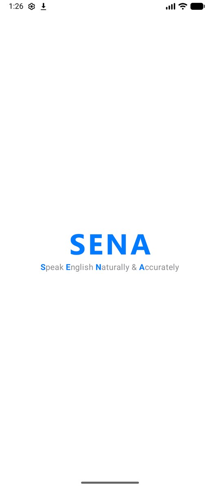
</p>

<h1 align="center">SENA — On-Device English Speaking Coach</h1>
<p align="center"><b>S</b>peak <b>E</b>nglish <b>N</b>aturally &amp; <b>A</b>ccurately</p>

<p align="center">
서버·클라우드·로그인 없이 <b>휴대폰 안에서만</b> 동작하는 영어회화 앱입니다.<br>
AI 대화 상대와 상황별 역할극을 하고, 내 발음·운율을 연구용 평가 모델로 채점받습니다.
</p>

---

## 목차

1. [주요 기능](#1-주요-기능)
2. [화면](#2-화면)
3. [최소 사양](#3-최소-사양)
4. [설치와 사용법](#4-설치와-사용법)
5. [들어 있는 모델](#5-들어-있는-모델)
6. [동작 과정](#6-동작-과정)
7. [검증 결과](#7-검증-결과)
8. [직접 빌드하기](#8-직접-빌드하기)
9. [폴더 구조](#9-폴더-구조)
10. [라이선스와 데이터](#10-라이선스와-데이터)

---

## 1. 주요 기능

| 기능 | 설명 |
|---|---|
| **자유 대화 (음성 통화형)** | 7개 상황(자유 대화, 카페 주문, 공항 입국 심사, 호텔 체크인, 길 묻기, 영어 면접, 옷 가게 쇼핑)에서 AI 상대와 영어로 말합니다. 상대가 내 영어 이름을 부르고 지난 대화를 기억해 이어 갑니다. 난이도 3단계(천천히 · 자연스럽게 · 원어민처럼) |
| **힌트 · 문자 모드** | 막히면 "이렇게 말해볼까요?" 힌트, 말하기 어려운 곳에서는 문자로 대화 |
| **한국어로 도움받기** | 영어가 떠오르지 않으면 한국어로 말하세요. AI가 대화 흐름에 맞는 영어 문장을 만들어 주고, 그 문장을 따라 말하면 그대로 내 대답이 됩니다. 따라 말한 문장도 발음·운율 점수를 받습니다 |
| **대화 리포트** | 대화가 끝나면 기억한 내용, 말하기 통계(문장 길이 · 말 속도 · 멈춤), 더 자연스러운 표현(문법 교정), 도움받은 표현, 전체 대화 내역을 보여 주고 이미지로 저장할 수 있습니다 |
| **튜토리얼** | 3레벨 24단원 144문장. 시범 듣기 → 녹음 → 발음·운율 점수와 한국인 학습자용 발음 팁. 리포트에서 교정된 문장은 "내 문장"으로 모입니다 |
| **홈 화면 위젯** | "오늘의 한 문장" — 누르면 바로 그 문장 연습 화면이 열립니다 |
| **개인정보** | 로그인 없음. 영어 이름과 모든 기록은 이 휴대폰에만 저장됩니다. 설치 후에는 인터넷 없이 동작합니다(대화 모델 최초 1회 다운로드 제외) |

## 2. 화면

> 캡처: Android 에뮬레이터(API 37), SENA v0.3.1 ~ v0.3.4

### 시작 · 홈

| 스플래시 | 홈(대화 탭) | 대화 모델 받기 | 설정 |
|:---:|:---:|:---:|:---:|
|  | 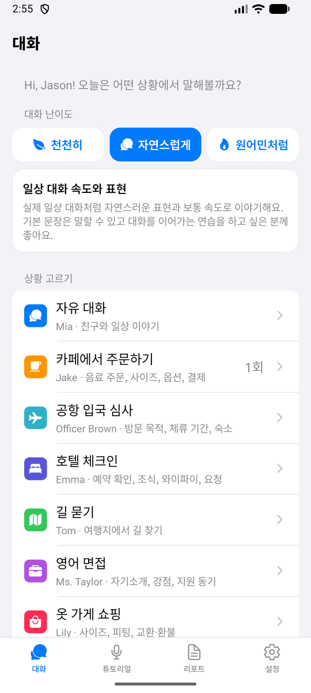 | 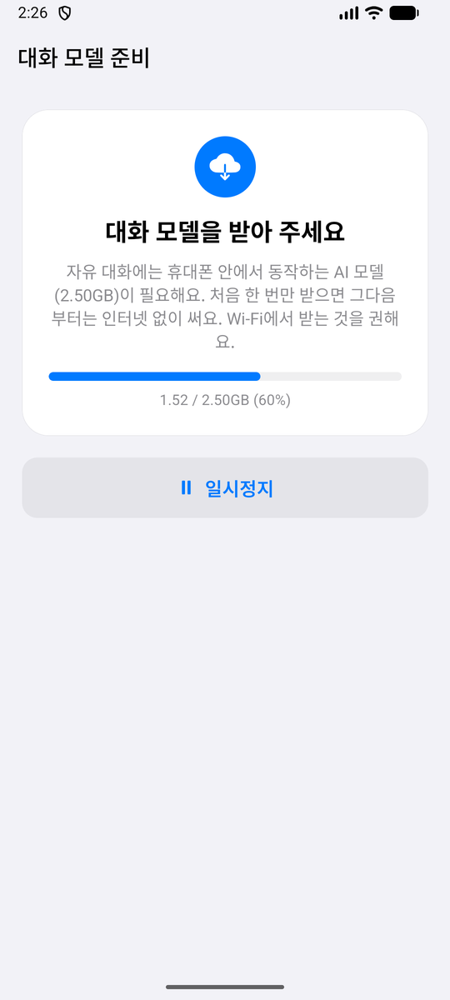 | 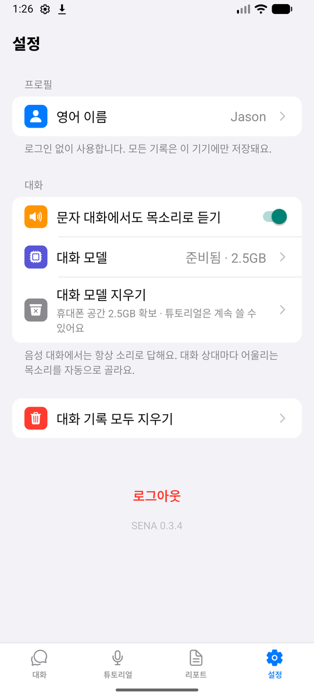 |
| 첫 화면 | 난이도와 상황 고르기 | 첫 실행 때 한 번 (2.5GB, 백그라운드·이어 받기) | 대화 모델 지우기로 2.5GB 확보 가능 |

### 자유 대화

| 음성 통화 | 힌트 | 문자 모드 | 한국어로 도움받기 |
|:---:|:---:|:---:|:---:|
| 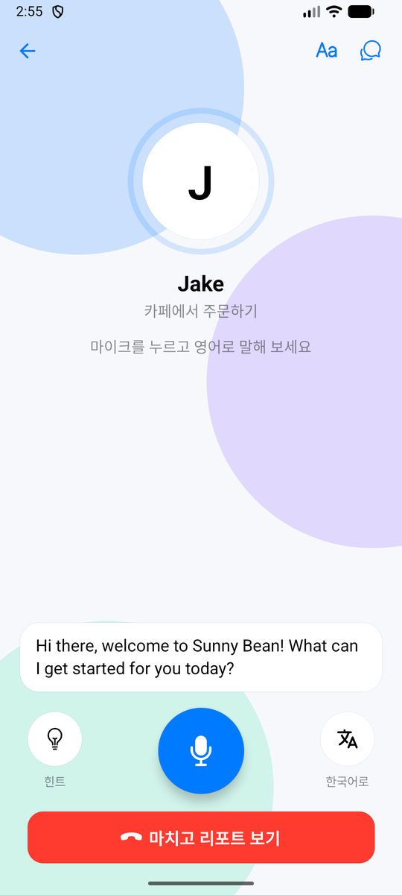 | 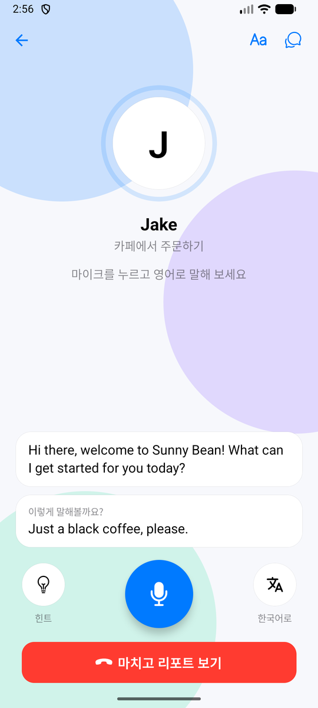 | 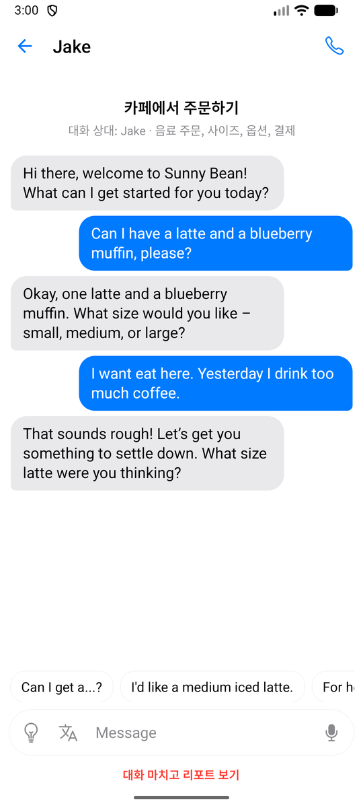 | 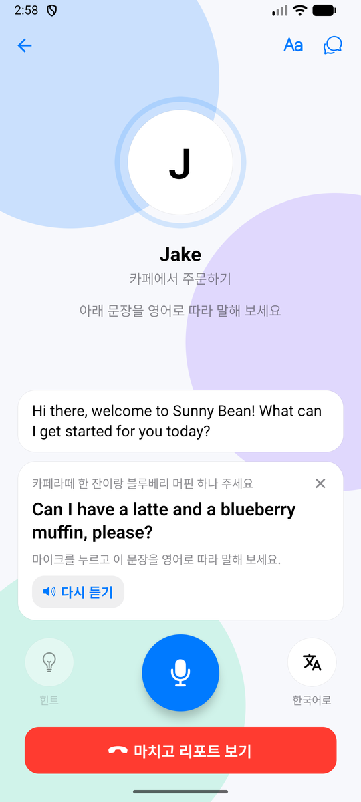 |
| 마이크를 누르고 영어로 말하기 | 막힐 때 예시 답변 | 표현 칩과 함께 문자로 | 한국어 → 영어 문장 → 따라 말하기 |

### 리포트 · 튜토리얼

| 리포트 | 교정 · 도움받은 표현 | 튜토리얼 레벨 | 단원 목록 |
|:---:|:---:|:---:|:---:|
| 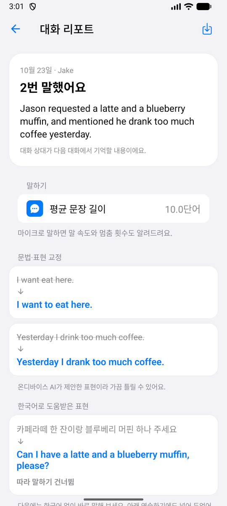 | 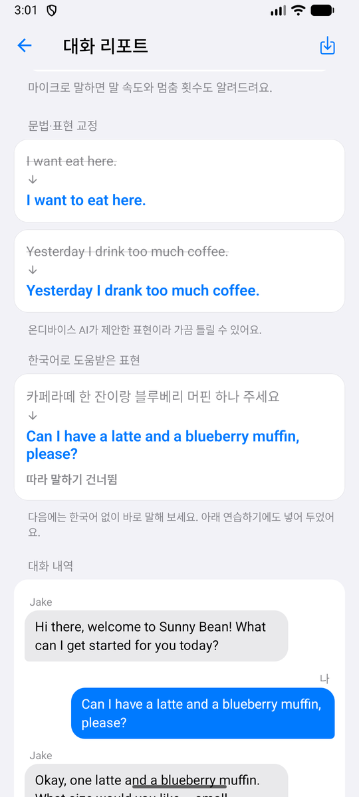 | 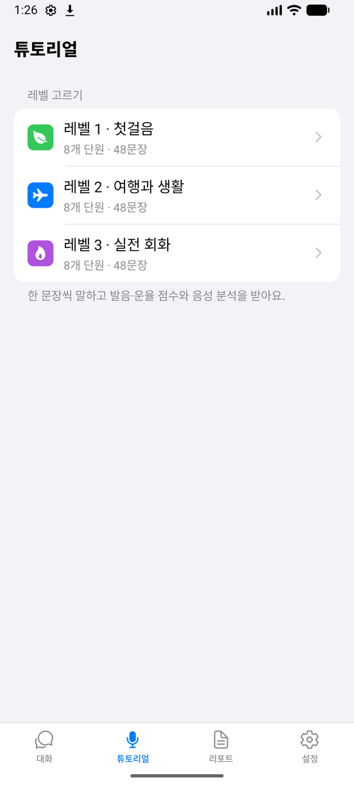 | 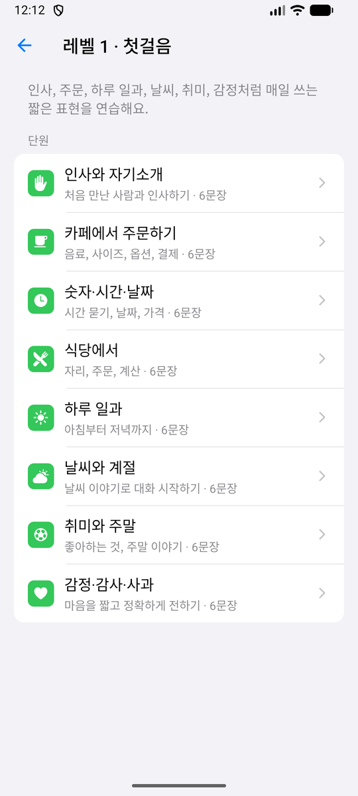 |
| 기억한 내용과 말하기 통계 | 더 자연스러운 표현 | 3레벨 · 레벨마다 8단원 | 상황별 6문장 |

| 문장 연습 | 홈 화면 위젯 | 기술 검증(개발자용) |
|:---:|:---:|:---:|
| 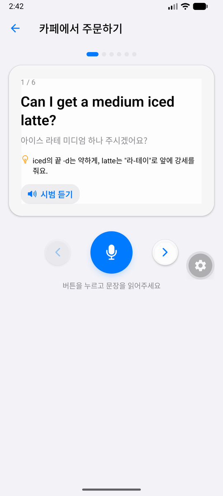 | 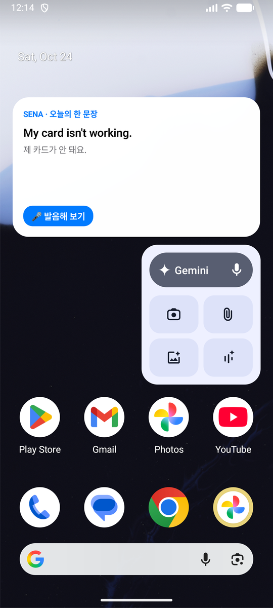 | 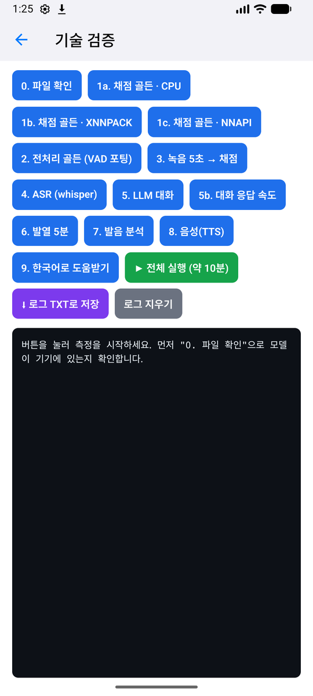 |
| 시범 듣기 · 발음 팁 · 녹음 | 오늘의 한 문장 | 전체 측정 실행 · 로그 TXT 저장 |

## 3. 최소 사양

| 항목 | 튜토리얼만 | 음성 대화까지 (권장) |
|---|---|---|
| OS | Android 7.0 (API 24) 이상 | Android 10 이상 |
| CPU | 64비트 ARM (arm64-v8a) | 최근 64비트 ARM |
| RAM | 3GB | **최소 6GB, 권장 8GB** (대화 모델 2.5GB + 대화 기록 캐시 + 음성 모델) |
| 저장 공간 | 약 0.4GB (APK 0.36GB) | **약 3.2GB** (앱 + 대화 모델 2.5GB, 받을 때 여유 공간 2.8GB 필요) |
| 인터넷 | 필요 없음 | 대화 모델을 처음 한 번 받을 때만 (Wi-Fi 권장) |
| 마이크 · 스피커 | 필요 | 필요 (TTS는 휴대폰 기본 음성 엔진, 영어 음성 데이터 필요) |

- 실측 기기: 삼성 SM-F971N(Android 17, RAM 10.6GB)에서 모든 기능이 정상 동작했습니다([7. 검증 결과](#7-검증-결과)).
- **보급형(RAM 3–4GB)·중급(6–8GB) 기기는 아직 실측하지 않았습니다.** 위 RAM 기준은 에뮬레이터 측정과 모델 크기로 추정한 값입니다.
- iOS는 아직 지원하지 않습니다(코드는 Expo로 작성되어 있어 이후 지원 예정).

## 4. 설치와 사용법

### 4-1. 설치 (시험 APK)

1. 시험용 APK(`SENA-v0.3.4-test.apk`, 약 0.36GB, arm64)를 휴대폰에 받습니다.
   - 현재 Play Store 출시 전이라 APK는 연구자가 따로 배포합니다. 직접 만들려면 [8. 직접 빌드하기](#8-직접-빌드하기)를 보세요.
2. 파일을 열어 설치합니다. 처음이면 "출처를 알 수 없는 앱 설치 허용"을 켜야 합니다.
3. 예전 버전이 있으면 그대로 덮어 설치해도 기록과 대화 모델이 유지됩니다.

### 4-2. 처음 실행

1. **영어 이름 입력** — 대화 상대가 이 이름으로 부릅니다. 로그인은 없습니다.
2. **대화 모델 받기** — "받기"를 누르면 2.5GB를 받습니다(Wi-Fi에서 수 분 ~ 수십 분).
   - 앱을 닫아도 계속 받고, 상단 알림에 진행률이 보입니다.
   - 인터넷이 끊겨도 다시 연결되면 받던 곳부터 이어 받습니다.
   - 받는 동안 "받는 동안 튜토리얼 하기"로 튜토리얼을 먼저 쓸 수 있습니다.
3. 알림 권한, 마이크 권한을 허용합니다.

### 4-3. 사용하기

- **대화 탭**: 난이도 → 상황을 고르고 마이크를 눌러 영어로 말합니다. 막히면 💡 힌트, 영어가 안 떠오르면 文A **한국어로**. 끝나면 **마치고 리포트 보기**.
- **튜토리얼 탭**: 레벨 → 단원 → 문장마다 🔊 시범 듣기 → 🎤 녹음 → 점수(1~5)와 팁. 제시한 문장과 다른 말을 하면 점수를 주지 않습니다.
- **리포트 탭**: 지난 대화 리포트 모음. 이미지로 저장할 수 있습니다.
- **설정 탭**: 영어 이름 바꾸기, 문자 대화에서도 목소리로 듣기, 대화 모델 지우기(2.5GB 확보), 대화 기록 모두 지우기, 로그아웃(모든 기록 삭제).
- **위젯**: 홈 화면을 길게 눌러 위젯 → SENA "오늘의 한 문장"을 추가합니다.

### 4-4. 기술 검증 화면 (연구·개발용)

설정 화면 맨 아래 버전 글자(`SENA 0.3.4`)를 길게 누르면 열립니다.
**▶ 전체 실행**으로 모든 측정(채점 정확도, 전처리, 녹음, 음성인식, 대화 속도, 발열, 발음 분석, TTS, 한국어 도움받기)을 차례로 실행하고(약 10분, 3번 항목에서 5초 동안 영어 문장을 읽어 주세요), **⬇ 로그 TXT로 저장**으로 결과를 파일로 저장합니다(저장 폴더는 Download 추천).

## 5. 들어 있는 모델

모든 추론은 휴대폰 CPU에서 실행됩니다.

| 역할 | 모델 | 크기 | 실행 엔진 | 위치 |
|---|---|---|---|---|
| **발음·운율 채점** | WavLM-base-plus 회귀 모델 (연구자 학습, 상위 2층 미세조정) → ONNX, 가중치만 int8(`MatMulNBits`, block 128) | 109MB | onnxruntime-react-native 1.24.3 (CPU) | APK 포함 |
| 발화 구간 검출 | Silero VAD v6.0.0 (ONNX) | 2.3MB | onnxruntime | APK 포함 |
| 영어 음성인식 | Whisper base.en, 8비트 양자화(q8_0) | 82MB | whisper.cpp (`whisper.rn`) | APK 포함 |
| **대화 · 교정 · 한영 변환** | Gemma 3 4B Instruct, Q4_K_M (GGUF) | 2.5GB | llama.cpp (`llama.rn`) | 첫 실행 때 다운로드 |
| 한국어 음성인식 | 휴대폰 기본 음성인식(기기 안 인식) | — | `expo-speech-recognition` | OS |
| 음성 합성(TTS) | 휴대폰 기본 TTS 엔진의 오프라인 영어 음성 | — | `expo-speech` | OS |

### 발음·운율 채점 모델

- 학습 데이터: AI-Hub 「교육용 한국인의 영어 음성 데이터」 (전처리 후 74,596건)
- 성능(test 7,432건, 사람 점수와의 피어슨 상관): **발음 0.730 · 운율 0.746**
- 경량화: 380MB → **109MB**, 정확도 변화 없음(PCC 0.7301 / 0.7460). fp16, 동적 int8, int4 등은 실행 조건에 따라 점수가 흔들려 탈락시켰습니다.
- 출력은 [발음, 운율] 두 점수, 화면에는 1~5점(0.5 단위)으로 표시합니다.

## 6. 동작 과정

<p align="center">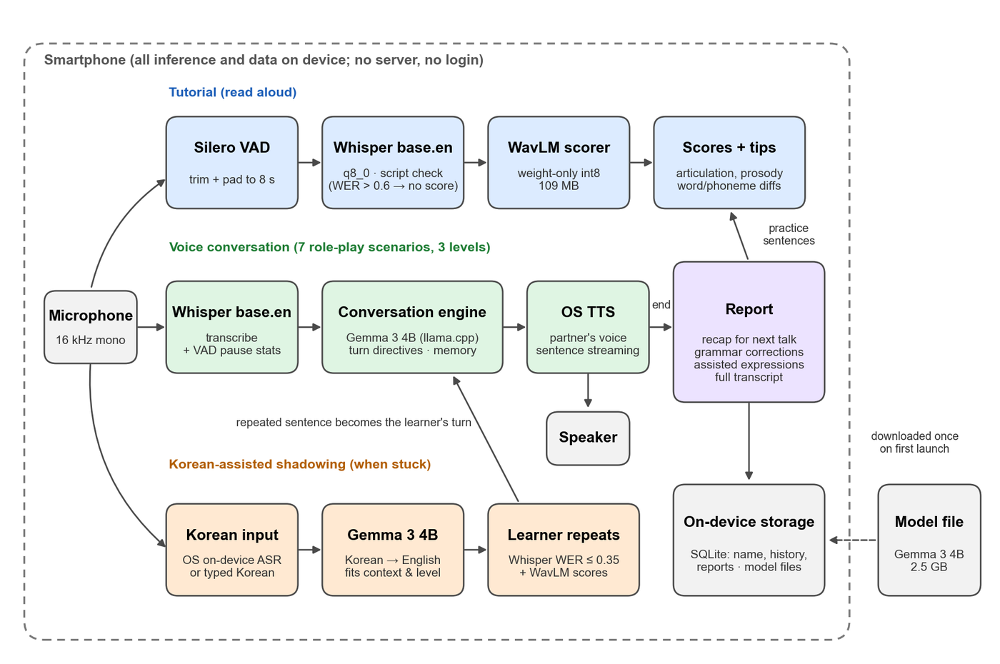</p>

### 채점 (튜토리얼 · 따라 말하기)

```
마이크 16kHz 모노
 → Peak 정규화 (x / max|x|)
 → Silero VAD(threshold 0.5): 첫 발화 시작 ~ 마지막 발화 끝 ±250ms로 자르기
 → 앞에서 8초(128,000샘플)까지, 짧으면 뒤를 0으로 채우기
 → Whisper 받아쓰기: 제시 문장과 WER 비교 (다른 문장이면 점수 없음)
 → WavLM 채점 모델 → [발음, 운율] → 1~5점 + 단어·음소 차이와 팁
```

앱의 TypeScript 전처리는 학습에 쓴 Python 전처리와 **샘플 단위로 같도록** 구현했습니다(300/300 일치). 길이나 패딩이 바뀌면 점수가 달라지기 때문입니다.

### 자유 대화

```
마이크 → Whisper 받아쓰기 (+ 말 속도 · 멈춤 측정)
 → 대화 엔진: 상황별 시스템 프롬프트 + 턴마다 짧은 지시(이름 부르기, 다음 단계)
              최근 대화는 그대로, 오래된 대화는 요약해 2,048토큰 안에 유지
 → Gemma 3 4B가 답을 생성 (문장 단위로 바로 TTS 재생)
 → 대화가 끝나면 리포트: 다음 대화용 기억, 문법 교정, 말하기 통계
```

### 한국어로 도움받기

```
한국어로 말하기(기기 안 인식) 또는 입력
 → Gemma 3 4B가 대화 맥락·난이도에 맞는 영어 한 문장으로 변환
 → 학습자가 따라 말하기 → Whisper WER ≤ 0.35이면 통과 → 그 문장이 대화 입력으로 들어가고 발음·운율 채점
```

## 7. 검증 결과

연구자 휴대폰(삼성 SM-F971N, Android 17, RAM 10.6GB, 시험 APK v0.3.3) 실측:

| 항목 | 결과 |
|---|---|
| 채점 정확도 (Python 기준 골든 7건) | 최대 오차 4.29×10⁻⁶ (CPU) |
| 전처리 일치 (골든 8건) | 8/8 샘플 단위 일치 |
| 8초 음성 채점 시간 | 중앙값 0.63초 (NNAPI 가속은 3.47초로 더 느려 CPU 사용) |
| 영어 음성인식 | 2.2–14.4초 음성을 0.95–1.43초에 받아쓰기 (RTF 0.17) |
| 대화 모델 | 로드 5.5–8.3초, 생성 10.1–14.9 토큰/초, 첫 토큰 0.31–1.18초 |
| 대화 응답 | 2·3턴의 첫 글자까지 약 2.0초 (첫 턴은 미리 계산으로 1.7초) |
| 5분 연속 채점 발열 | 지연 1.03배 (거의 변화 없음) |
| 한국어 → 영어 변환 | 첫 호출 8.1초, 이후 2.6–3.4초 |
| 따라 말하기 판정 | 같은 문장 통과 7/8, 다른 문장 차단 8/8 |

PC 평가: 대화 문맥 기억 98%(64개 중 63개, Gemma 3 4B), 한국어 → 영어 변환 적합도 87.3%, 리포트 문법 교정 재현율 80% · 오교정 13% (`docs/`의 각 보고서).

## 8. 직접 빌드하기

> 모델 파일(채점 모델, VAD, Whisper)은 저장소에 들어 있지 않습니다. 대화 모델은 앱이 직접 받습니다.

### 준비물

- Node.js 20+, JDK 17, Android Studio (SDK 36, NDK, CMake, Platform-Tools)
- Windows라면: 프로젝트를 **영문·공백 없는 짧은 경로**(예: `C:\dev\sena-mobile`)에 두고, 긴 경로 허용(`LongPathsEnabled=1`)을 켜세요. C++ 빌드 경로가 260자를 넘습니다.
- 모델 폴더(예: `C:\dev\sena-models`):

| 파일 | 출처 |
|---|---|
| `sena_scorer.onnx` | 연구자 학습 모델 (별도 배포) |
| `silero_vad.onnx` | [snakers4/silero-vad](https://github.com/snakers4/silero-vad) v6.0.0 |
| `ggml-base.en-q8_0.bin` | [ggerganov/whisper.cpp](https://huggingface.co/ggerganov/whisper.cpp) |
| `golden/`, `golden_raw/` | (선택) 기술 검증용 골든 샘플 |

### 빌드

```powershell
npm install                       # PowerShell에서 실행 (patch-package가 라이브러리 패치를 자동 적용)
$env:SENA_BUNDLE_MODELS = 'C:\dev\sena-models'
npx expo prebuild --platform android --no-install
cd android
.\gradlew.bat assembleRelease "-PreactNativeArchitectures=arm64-v8a,x86_64"
```

결과: `android/app/build/outputs/apk/release/app-arm64-v8a-release.apk` (휴대폰용), `app-x86_64-release.apk` (에뮬레이터용).

개발 중에는 `npx expo run:android`로 개발 빌드를 설치할 수 있습니다.

### PC 검증 스크립트

```powershell
npm test               # 단위 테스트: 이름 검증, 문장 일치(WER), 문장 길이, 교정 필터
npm run typecheck      # TypeScript 타입 검사
npm run verify:pc -- "<연구 폴더>"   # 앱 전처리·채점 = Python 기준 (onnxruntime-node)
npm run sim:chat       # 7개 상황 대화 시뮬레이션 (Ollama)
npm run sim:report     # 리포트 문법 교정 정확도
```

자세한 모듈 설명은 [`docs/DEVELOPMENT.md`](docs/DEVELOPMENT.md)를 보세요.

## 9. 폴더 구조

```
app/                 화면 (Expo Router)
  (tabs)/            대화 · 튜토리얼 · 리포트 · 설정 탭
  chat/[id].tsx      대화 화면 (음성·문자·힌트·한국어로 도움받기)
  report/[id].tsx    대화 리포트
  tutorial/          레벨 · 단원 · 문장 연습
  model-import.tsx   대화 모델 받기
  dev.tsx            기술 검증 화면
src/
  audio/             녹음, WAV, Peak 정규화, Silero VAD 포팅, 전처리
  models/            채점(ONNX), Whisper, LLM, 모델 설치 · 다운로드
  chat/              대화 엔진, 프롬프트, 상황 7종, 리포트, 한국어 도움받기
  tutorial/          단원 · 문장 콘텐츠, 채점, 문장 일치(WER)
  store/             SQLite (이름, 대화, 리포트, 점수)
  widget/            홈 화면 위젯
  bench/             기술 검증 측정 항목
modules/sena-download/   대화 모델 백그라운드 다운로드 (Kotlin, WorkManager, 이어 받기)
plugins/             Android 빌드 설정 플러그인 (모델 번들, ProGuard, 백업 제외 등)
patches/             라이브러리 패치 (patch-package)
scripts/             PC 검증 · 시뮬레이션 스크립트
docs/                평가 보고서, 화면 캡처, 개발 문서
```

## 10. 라이선스와 데이터

- 대화 모델 **Gemma 3**는 [Gemma Terms of Use](https://ai.google.dev/gemma/terms)를 따릅니다.
- Whisper(MIT), whisper.cpp(MIT), llama.cpp(MIT), Silero VAD(MIT), ONNX Runtime(MIT)
- 채점 모델 학습에 쓴 AI-Hub 데이터는 이 저장소에 포함되어 있지 않으며, AI-Hub 이용 약관에 따라 재배포하지 않습니다.
- 연구 내용은 후속 논문(온디바이스 SENA)으로 정리 중입니다.
